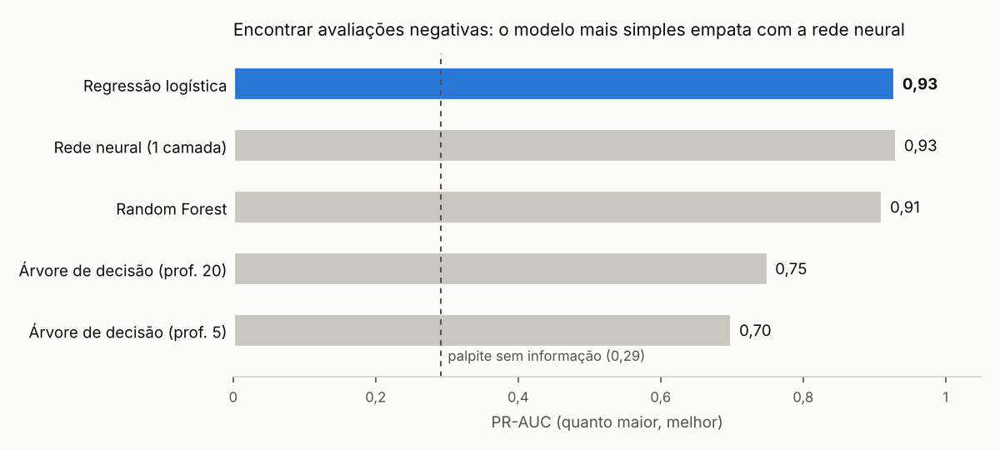
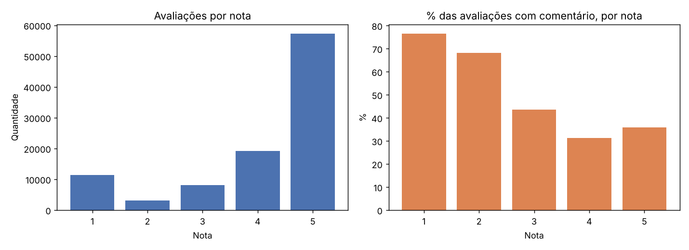

# Classificador de Reviews Olist

[](https://github.com/rafaelsimoesdev/classificador-reviews-olist/actions/workflows/testes.yml)

**Autor:** Rafael Simões  
**Dataset:** [Brazilian E-Commerce Public Dataset by Olist, Kaggle](https://www.kaggle.com/datasets/olistbr/brazilian-ecommerce)  
**Pergunta:** Dado o comentário de um cliente, a avaliação é positiva ou negativa?

**🔗 Demo ao vivo:** [Testar a API (Swagger)](https://reviews-olist-api-889571326423.southamerica-east1.run.app/docs)  
*Python · scikit-learn · FastAPI · Docker · GCP Cloud Run · GitHub Actions*

> A API fica parada quando ninguém usa, então a primeira chamada pode levar alguns segundos.

---

## Resultados em resumo



- **37.380 comentários reais**, 29% negativos. Um palpite sem informação teria PR-AUC de 0,29; o modelo chega a **0,93**.
- **O modelo mais simples venceu.** A regressão logística empatou com uma rede neural e treinou cerca de 50 vezes mais rápido, além de explicar cada decisão pelas palavras que pesaram.
- **Nem todo erro é do modelo.** Numa amostra de 50 erros, um quarto tinha texto e nota contraditórios ("excelente" com nota 1).
- **Os erros reais eram reclamações sem emoção** ("o produto chegou rasgado"). Com o limiar escolhido só no treino, o modelo encontra **94,7% das avaliações negativas**, com 81% de precisão.
- **No ar:** API com FastAPI, Docker e Google Cloud Run, com testes automáticos a cada commit.

---

## Contexto

Depois de prever atrasos de entrega ([Projeto 2](https://github.com/rafaelsimoesdev/previsao-atraso-entregas) e [Projeto 3](https://github.com/rafaelsimoesdev/deliveryrisk-api)), este projeto olha para o outro lado da operação: o que o cliente escreve depois de receber o pedido. Ler milhares de comentários manualmente não escala. Um classificador de texto permite priorizar as avaliações negativas e descobrir o que as motiva.

## Definição do alvo

| Nota | Classe |
|---|---|
| 1 e 2 | Negativa |
| 4 e 5 | Positiva |
| 3 | Descartada (sentimento ambíguo) |

Só entram na análise as avaliações que têm comentário em texto.

## Etapas do projeto

- [x] Exploração dos dados (notas, comentários, tamanho do texto)
- [x] Definição do alvo e análise do desbalanceamento
- [x] Limpeza do texto
- [x] Baseline e TF-IDF + regressão logística (ROC-AUC e PR-AUC)
- [x] Comparação com árvore de decisão e Random Forest
- [x] Análise de erros: o que o modelo erra e por quê
- [x] Comparação com uma rede neural (MLP)
- [x] Modelo final com limiar escolhido no treino
- [x] API com FastAPI, Docker e deploy no Google Cloud Run
- [x] Testes automáticos da API (GitHub Actions)

> A numeração segue os scripts em `src/`: a etapa 1 é baixar o dataset do Kaggle (veja [Como reproduzir](#como-reproduzir)).

## Etapa 2: exploração das reviews

Script: [`src/etapa2_explorar_reviews.py`](src/etapa2_explorar_reviews.py)



| | Valor |
|---|---|
| Avaliações | 99.224 |
| Com comentário em texto | 40.977 (41%) |
| Notas 1-2 com comentário | 10.890 |
| Notas 4-5 com comentário | 26.530 |
| Nota 3 com comentário (descartada) | 3.557 |
| **Base final para o modelo** | **37.420 comentários** |

- **Desbalanceamento:** 29% negativas e 71% positivas. Um modelo que responde "sempre positiva" acerta 71% sem entender nada, então a acurácia sozinha engana. A avaliação usará precisão, recall, ROC-AUC e PR-AUC.
- **Quem escreve mais:** 77% das avaliações com nota 1 têm comentário, contra 36% das de nota 5. Os comentários negativos estão bem representados.
- **Textos curtos:** a mediana é de 9 palavras (máximo de 45). Alguns comentários têm só espaços e serão removidos na limpeza.

---

## Etapa 3: limpeza do texto

Script: [`src/etapa3_limpar_texto.py`](src/etapa3_limpar_texto.py)

O que o script faz: mantém só avaliações com comentário (sem a nota 3), cria o alvo (1 = negativa, 0 = positiva), converte para minúsculas, remove links, quebras de linha e espaços repetidos, e descarta comentários vazios e duplicados do mesmo pedido.

| | Valor |
|---|---|
| Antes da limpeza | 37.420 comentários |
| Vazios removidos | 26 |
| Duplicados removidos (mesmo pedido e texto) | 14 |
| **Base final** | **37.380 comentários** |
| Negativas / positivas | 10.889 (29,1%) / 26.491 (70,9%) |

**Palavras mais associadas a cada classe** (quantas vezes aparecem mais em uma classe que na outra, com no mínimo 30 ocorrências):

| Negativas | Positivas |
|---|---|
| péssima (52x), dinheiro (48x), insatisfeita (45x), reembolso (43x), descaso (41x), providências (39x), estorno (38x) | amei (66x), ótimo (54x), excelente (51x), adorei (44x), parabéns (37x), perfeito (27x) |

- **Queixas de atendimento, não só de produto:** "reembolso", "estorno", "providências" e "descaso" mostram que muitos comentários negativos falam da resposta da loja ou da devolução do dinheiro, além do item entregue.
- **Acentos inconsistentes:** "péssima" e "pessima", "ótima" e "otima" aparecem como palavras diferentes. Isso divide o sinal entre duas grafias, então a etapa seguinte compara o modelo com e sem normalização de acentos.

---

## Etapa 4: baseline e regressão logística

Script: [`src/etapa4_baseline_regressao_logistica.py`](src/etapa4_baseline_regressao_logistica.py)

Os comentários foram divididos em 80% para treino e 20% para teste (7.476 comentários), de forma estratificada, **antes** de qualquer ajuste. O texto vira números com TF-IDF (palavras e pares de palavras que aparecem em pelo menos 3 comentários), e o vocabulário é aprendido só com o treino.

| Modelo | ROC-AUC | PR-AUC | Precisão (negativa) | Recall (negativa) |
|---|---|---|---|---|
| "Sempre positiva" (baseline) | 0,500 | 0,291 | 0% | 0% |
| TF-IDF + regressão logística | 0,971 | 0,927 | 87,6% | 89,0% |
| Com acentos normalizados | 0,971 | 0,929 | 87,8% | 89,7% |

- **Sinal forte:** o PR-AUC de 0,93 é mais de 3 vezes o do baseline (0,29, que é a taxa de negativas). As pessoas costumam dizer a nota com as próprias palavras.
- **Normalizar acentos mudou pouco** (PR-AUC de 0,927 para 0,929). Com uma única divisão, essa diferença é pequena demais para se afirmar que ajuda.
- **Os coeficientes são legíveis.** Termos que mais empurram para negativa: "não" (11,4), "não recomendo", "péssima", "não recebi", "aguardando". Para positiva: "excelente", "recomendo", "parabéns", "rápida".

---

## Etapa 5: árvores de decisão e Random Forest

Script: [`src/etapa5_arvores.py`](src/etapa5_arvores.py). Mesma divisão e mesmo TF-IDF da etapa 4, com acentos normalizados.

| Modelo | ROC-AUC | PR-AUC | Precisão (neg.) | Recall (neg.) | Tempo de treino |
|---|---|---|---|---|---|
| **Regressão logística** | **0,971** | **0,929** | 87,8% | 89,7% | 0,5 s |
| Árvore (profundidade 5) | 0,858 | 0,700 | 74,6% | 75,1% | 0,3 s |
| Árvore (profundidade 20) | 0,896 | 0,751 | 77,0% | 82,9% | 1,4 s |
| Random Forest (300 árvores) | 0,964 | 0,912 | 78,9% | 92,9% | 12,5 s |

- **A regressão logística foi a melhor e a mais barata.** Em texto, cada comentário vira mais de 17 mil colunas quase todas zeradas, formato em que modelos lineares funcionam bem.
- **Uma árvore sozinha fica bem atrás** (PR-AUC de 0,70 a 0,75), mas é legível: a primeira pergunta é "o comentário tem 'não'?".
- **O Random Forest tem o maior recall** (92,9%), mas com menos precisão. Parte disso vem do `class_weight="balanced"`, que o deixa mais sensível à classe negativa.
- **Os modelos concordam na pista principal:** a palavra "não" é o termo mais importante em ambos, seguida de "recebi" e "não recebi".
- **Limites:** uma única divisão aleatória e sem ajuste de hiperparâmetros do Random Forest. O que a comparação sustenta é que o Random Forest **não** supera a regressão logística aqui.

---

## Etapa 6: análise de erros

Script: [`src/etapa6_analise_erros.py`](src/etapa6_analise_erros.py). Modelo analisado: TF-IDF + regressão logística, com acentos normalizados.

O modelo errou **495 dos 7.476 comentários de teste (6,6%)**: 224 negativos classificados como positivos (falsos negativos) e 271 positivos classificados como negativos (falsos positivos).

**Onde ele erra mais:**

| Recorte | Taxa de erro |
|---|---|
| Nota 5 | 2,9% |
| Nota 1 | 7,4% |
| Nota 4 | 12,7% |
| Nota 2 | **21,0%** |
| Comentários de 1 a 3 palavras | 3,8% |
| Comentários com 16 palavras ou mais | **11,8%** |

- **Notas 2 e 4 são as mais difíceis**, porque ficam perto da fronteira entre satisfeito e insatisfeito.
- **Comentários longos erram mais**, porque misturam elogio e reclamação. "Mas", "porém" e similares aparecem em 9,5% do teste, mas em 20% dos falsos negativos e 26% dos falsos positivos.

### Lendo os erros: uma amostra de 50

Para entender os erros, uma amostra aleatória de 50 deles foi lida e classificada em três grupos, com apoio de IA ([`docs/amostra_erros_rotulada.csv`](docs/amostra_erros_rotulada.csv)):

| Grupo | Casos | Exemplo |
|---|---|---|
| **A nota contradiz o texto** | 12 (24%) | "excelente" com nota 1; "até agora não recebi" com nota 4 |
| **Texto misto ou neutro** | 17 (34%) | "o produto é bom porém não veio na cor que solicitei" (nota 4) |
| **Erro real do modelo** | 21 (42%) | "o produto chegou rasgado" (nota 2), classificado como positivo |

- **Um quarto dos "erros" não é do modelo.** Nesses casos o texto diz uma coisa e a nota diz outra: o cliente provavelmente escolheu a nota errada, ou avaliou outra coisa (o vendedor, a entrega). O modelo leu o texto corretamente. Isso mostra um limite da própria base: a nota não é um rótulo perfeito do sentimento.
- **Um terço é genuinamente ambíguo.** Comentários com elogio e crítica, ou só informativos ("o pedido foi cancelado por mim"), não têm uma resposta certa clara.
- **Os erros reais são quase todos negativos perdidos** (19 de 21), e seguem um padrão: são **reclamações factuais, sem palavras de emoção**. "Chegou rasgado", "embalagem inadequada, chegou amassado", "venceu o prazo de entrega ontem". O modelo aprendeu a reconhecer "péssimo" e "não recomendo", mas não que "rasgado" e "amassado" também são problemas.

A classificação tem subjetividade: outra pessoa poderia mover alguns casos entre "misto" e "erro do modelo" (por exemplo, "o jogo de cama é bonito, no entanto deixa a desejar em acabamento", com nota 2). Os números são uma estimativa, não uma medida exata.

### O limiar de decisão

Os negativos perdidos ficam com probabilidade entre 0,21 e 0,46, logo abaixo do limiar padrão de 0,5. Baixar o limiar recupera boa parte deles:

| Limiar | Precisão | Recall | Comentários sinalizados |
|---|---|---|---|
| 0,5 (padrão) | 87,8% | 89,7% | 29,8% |
| 0,4 | 84,5% | 92,4% | 31,9% |
| 0,3 | 80,4% | 95,4% | 34,5% |
| 0,2 | 73,8% | 97,6% | 38,5% |

Para uma equipe de atendimento que quer encontrar avaliações negativas, perder uma reclamação custa mais do que ler um comentário a mais, então um limiar mais baixo faz sentido. Esses números vêm do conjunto de teste e servem só para mostrar a troca. O limiar usado na API foi escolhido apenas com dados de treino, na [etapa 8](#etapa-8-modelo-final-e-api).

---

## Etapa 7: rede neural

Script: [`src/etapa7_rede_neural.py`](src/etapa7_rede_neural.py). Mesma divisão e mesmo TF-IDF. Cada rede foi treinada 5 vezes com sementes diferentes, porque o resultado muda com a inicialização dos pesos.

| Modelo | ROC-AUC | PR-AUC | Tempo de treino |
|---|---|---|---|
| Regressão logística | 0,971 | 0,929 | 0,3 s |
| Rede com 1 camada (64 neurônios) | 0,973 ± 0,000 | 0,932 ± 0,001 | 17 s |
| Rede com 2 camadas (128 e 32) | 0,972 ± 0,000 | 0,929 ± 0,001 | 27 s |

- **A rede empata com a regressão logística.** Ela ganha 0,003 de PR-AUC, mas leva cerca de 50 vezes mais tempo para treinar. Mais camadas não ajudaram.
- **Por quê:** com TF-IDF, cada palavra já é uma entrada separada, e o sinal é quase linear ("péssimo" puxa para negativo, "amei" para positivo). A regressão logística é, na prática, uma rede neural de um único neurônio com função sigmoide. Camadas extras só ajudam quando há padrões que as palavras soltas não mostram, e para captá-los a rede precisaria de representações como embeddings.
- **Decisão:** a regressão logística segue como o modelo do projeto. É tão boa quanto a rede, mais rápida e explicável pelos coeficientes.

---

## Etapa 8: modelo final e API

Script: [`src/etapa8_treinar_modelo_final.py`](src/etapa8_treinar_modelo_final.py)

A análise de erros mostrou que muitas reclamações factuais ("chegou rasgado") ficam logo abaixo do limiar padrão de 0,5. Para a API, o limiar foi escolhido **só com os dados de treino** (predições out-of-fold), buscando encontrar pelo menos 95% das avaliações negativas. O teste foi usado uma única vez, para medir:

| Limiar | Precisão | Recall | Comentários sinalizados |
|---|---|---|---|
| 0,50 (padrão) | 87,8% | 89,7% | 29,8% |
| **0,31 (escolhido no treino)** | **81,0%** | **94,7%** | 34,0% |

Depois da avaliação, o modelo foi retreinado com os 37.380 comentários e salvo com as mesmas versões usadas na API (scikit-learn 1.5.2), para evitar incompatibilidade ao carregar o arquivo.

### Usando a API

```bash
curl -X POST "https://reviews-olist-api-889571326423.southamerica-east1.run.app/classificar" \
  -H "Content-Type: application/json" \
  -d '{"texto": "O produto chegou rasgado"}'
```

```json
{
  "negativa": true,
  "probabilidade_negativa": 0.379,
  "confianca": "BAIXA",
  "termos_relevantes": ["chegou rasgado", "rasgado", "produto"]
}
```

| Endpoint | O que faz |
|---|---|
| `POST /classificar` | Classifica um comentário |
| `GET /model/info` | Limiar, métricas e termos mais importantes do modelo |
| `GET /health` | Verificação de saúde (Cloud Run) |
| `GET /docs` | Documentação interativa (Swagger) |

- **`termos_relevantes`** mostra as palavras do comentário que mais pesaram na decisão (peso TF-IDF × coeficiente da regressão logística). É a vantagem de um modelo linear: dá para explicar cada resposta.
- **`confianca`** indica a distância até o limiar. "BAIXA" significa que o comentário está perto da fronteira e vale uma leitura humana.

### Rodando localmente

```bash
pip install -r requirements.txt
uvicorn app.main:app --port 8080
# ou com Docker
docker build -t reviews-olist-api . && docker run -p 8080:8080 reviews-olist-api
```

### Testes

[`tests/test_api.py`](tests/test_api.py) verifica comentários claramente negativos e positivos, se acentos e maiúsculas mudam o resultado (não devem), a rejeição de texto vazio e as informações do modelo. Eles rodam automaticamente no GitHub Actions a cada commit.

```bash
pip install -r requirements.txt -r requirements-dev.txt
pytest
```

---

## Limitações

- **A nota não é um rótulo perfeito.** Na amostra de erros, cerca de um quarto dos casos tinha texto e nota contraditórios. Parte do erro medido é da base, não do modelo.
- **O modelo conhece palavras, não contexto.** Ironia e comentários que misturam elogio e crítica continuam difíceis.
- **Dados de 2016 a 2018.** O vocabulário dos clientes pode ter mudado; em produção seria preciso monitorar e retreinar.
- **Uma única divisão de teste.** As diferenças pequenas entre modelos (por exemplo, rede neural contra regressão logística) estão dentro do que pode variar com outra divisão.

---

## Próximos passos

- **Comparar com um LLM:** classificar uma amostra com um modelo de linguagem e comparar acerto, custo e casos difíceis (ironia, comentários mistos).
- **Automação:** um fluxo que recebe avaliações novas, chama a API e avisa a equipe quando uma é negativa.

---

## Estrutura

```
classificador-reviews-olist/
├── .github/      # testes automáticos (GitHub Actions)
├── app/          # API (FastAPI)
├── model/        # modelo treinado (model.pkl)
├── dados/        # CSVs do Kaggle (não versionados, crie a pasta localmente)
├── src/          # scripts de cada etapa
├── docs/         # gráficos e métricas
├── tests/        # testes da API
├── Dockerfile
├── requirements.txt       # API
├── requirements-dev.txt   # treino, gráficos e testes
└── README.md
```

## Como reproduzir

1. Baixe o dataset no [Kaggle](https://www.kaggle.com/datasets/olistbr/brazilian-ecommerce) e coloque `olist_order_reviews_dataset.csv` na pasta `dados/`.
2. Instale as dependências: `pip install -r requirements.txt -r requirements-dev.txt`
3. Rode os scripts em ordem, da raiz do projeto:

```bash
python src/etapa2_explorar_reviews.py
python src/etapa3_limpar_texto.py              # gera dados/reviews_limpas.csv
python src/etapa4_baseline_regressao_logistica.py
python src/etapa5_arvores.py
python src/etapa6_analise_erros.py
python src/etapa7_rede_neural.py               # leva 1 a 2 minutos
python src/etapa8_treinar_modelo_final.py      # gera model/model.pkl
python src/grafico_comparacao_modelos.py       # gera docs/comparacao_modelos.png
```

---

**Autor:** Rafael Simões · [LinkedIn](https://linkedin.com/in/rafael-sim%C3%B5es-556979239) · [GitHub](https://github.com/rafaelsimoesdev)  
Outros projetos: [Previsão de Atraso de Entrega](https://github.com/rafaelsimoesdev/previsao-atraso-entregas) · [DeliveryRisk API](https://github.com/rafaelsimoesdev/deliveryrisk-api)
